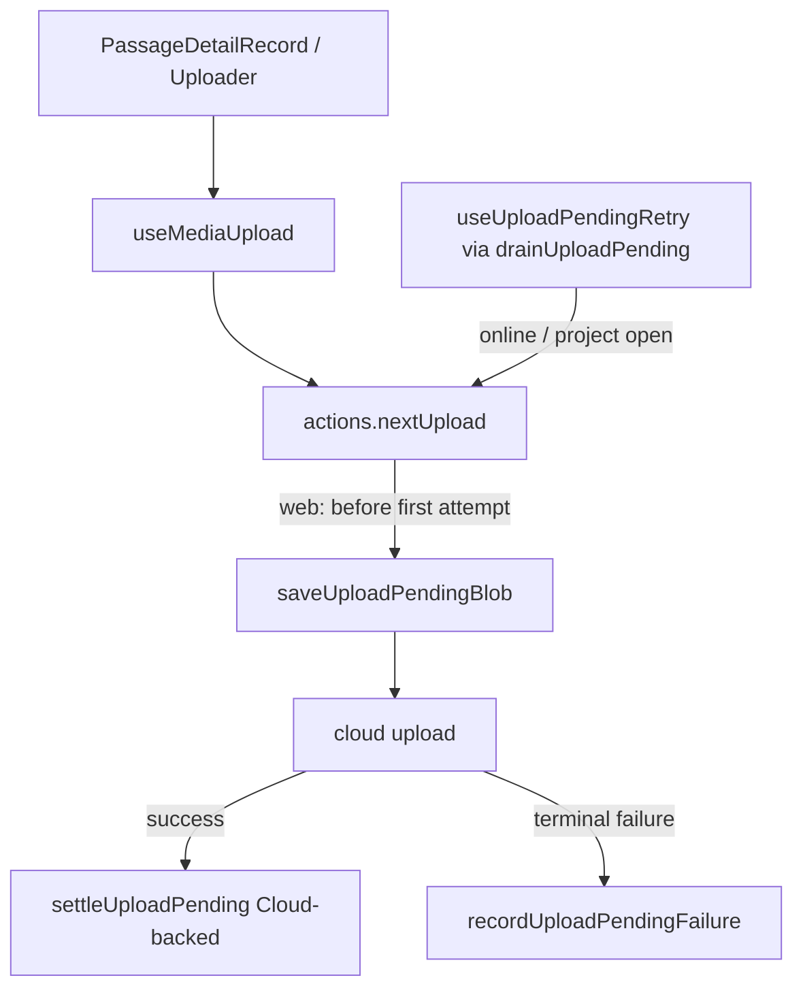

# media-persist step 02 redesign (post-#801 / #808)

Status: design only — do not implement until this note is reviewed.
Base: `media-persist-01-idb-store` (`780cfab5`) on current develop.
Archaeology reference: `archive/media-persist-02-write-pending` (`dc255b15`).

## Goal (unchanged)

On web, every new recording is saved as an **Upload Pending** Local Media Blob
*before* the first cloud attempt. Failure leaves it Upload Pending; success
marks it **Cloud-backed** under the server mediafile id. Opening a project and
the browser `online` event drain the current project's Upload Pending blobs.
Desktop keeps the localStorage pending queue; web does not use it for bytes
(ADR 0016).

## What moved on develop

| Seam | Then (archive tip) | Now (develop) | Implication |
|---|---|---|---|
| Upload orchestration | Split across `Uploader` + `actions.nextUpload` | Pipeline merged into [`useMediaUpload`](../../web/src/crud/useMediaUpload.ts) (#801); `Uploader` is a thin shell | Hook `projectId` / protect-on-device through `useMediaUpload` → `nextUpload`, not by patching `Uploader` |
| Record step | Pre-overhaul `PassageDetailRecord` | Rewritten (#808); still uses `Uploader` + `pendingMediaUploads` localStorage helpers for duplicate-pending warn | Keep the warn UX; swap the *source of truth* for “has pending for this passage” to the Local Media Blob store when web |
| Pending queue | Desktop path + early web localStorage | Still [`pendingMediaUploads.ts`](../../web/src/store/upload/pendingMediaUploads.ts) (path + restore metadata) | Web Upload Pending metadata rides on the blob store (`uploadPendingBlobs`); desktop queue stays |
| `nextUpload` | Direct protect-on-device inside actions | Same `NextUploadProps` shape, including `pendingUploadIdToClearOnSuccess` / `pendingRestore` | Re-introduce web `protectOnDevice` + `settleUploadPending` / `recordUploadPendingFailure` inside `nextUpload`; pass `projectId` from `useMediaUpload` |

## Port from archaeology (reuse as modules, not hunks)

Keep these shapes; re-apply against current files rather than cherry-picking:

1. `web/src/store/upload/uploadPendingBlobs.ts` (+ tests) — save / claim / settle / list / identity lookup.
2. `web/src/store/upload/drainUploadPending.ts` (+ tests) — sequential drain, stop on first failure.
3. `web/src/crud/useUploadPendingRetry.ts` — `online` + project-open drain via `nextUpload`.
4. ADR 0016 closing paragraph about `nextUpload` / online drain / no web localStorage queue.
5. Intent of `actions.webUploadPending.test.ts` — rewrite against current `nextUpload`.

Do **not** merge the archive hunks for `PassageDetailRecord.tsx` or `Uploader.tsx`; re-wire from current #808/#801 versions.

## Integration plan

1. **`useMediaUpload`**: always pass `projectId: getGlobal('project')` into `nextUpload` (archive delta was one line; still missing on develop).
2. **`nextUpload` (web branch)**:
   - Before cloud: `saveUploadPendingBlob` with record snapshot + restore; claim in-flight key.
   - On success: `settleUploadPending` (re-key to mediafile id, mark Cloud-backed).
   - On terminal failure: `recordUploadPendingFailure` (retry count); do not use desktop path queue for bytes.
   - Skip desktop `writeFileLocal` / localStorage pending for web bytes.
3. **`DataChanges`**: mount `useUploadPendingRetry()` (same as archive).
4. **`PassageDetailRecord`**: `hasPendingUploadForPassage` / clear helpers should consult `uploadPendingBlobs` on web so the replace-pending warning stays accurate after local-first saves.
5. **Tests**: unit-test `uploadPendingBlobs` + `drainUploadPending` first; then a focused `nextUpload` web pending suite; then a Record-step test that a save creates an Upload Pending blob before cloud success.

## Explicit non-goals for step 02

- Pending UI list / project-switch dialog (step 05).
- Quota eviction (step 06).
- Offline Available bulk download (step 07).
- Service-worker chunked serving (step 08).
- Local-first *playback* (step 03 — independent read path).

## Suggested commit order inside step 02

1. `uploadPendingBlobs` + tests (no call sites).
2. `drainUploadPending` + `useUploadPendingRetry` + DataChanges mount.
3. `nextUpload` / `useMediaUpload` protect-settle wiring + web pending tests.
4. PassageDetailRecord pending-identity helpers on web + Record test.
